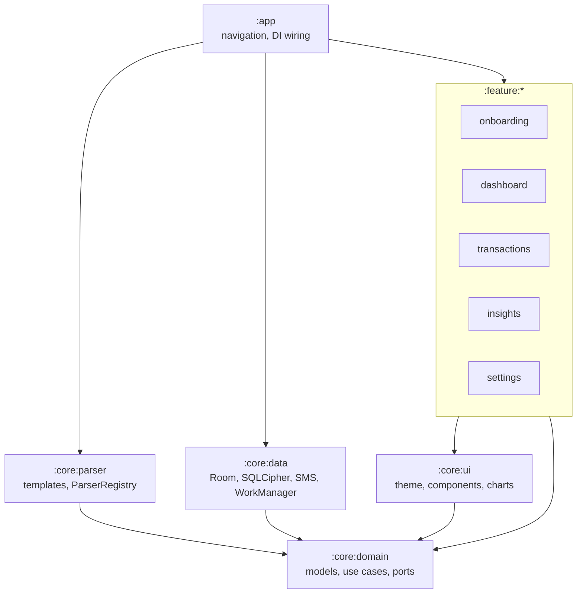

# Architecture

KwachaTrack is a layered, multi-module MVVM app: Jetpack Compose UI at the top, a pure Kotlin domain and parser in the middle, and Room plus Android SMS access at the edge.

Arrows are compile-time dependencies. The domain depends on nothing Android-specific; the parser depends only on the domain.

## How a new SMS flows through the app

1. `SmsReceiver` gets `SMS_RECEIVED`, joins multipart messages, and drops anything not from a provider sender.
2. It enqueues `ImportSmsWorker` (WorkManager), so the work survives the receiver's short lifetime.
3. The worker calls `ImportSmsUseCase.importOne`, which asks the `TransactionParser` port (implemented by `ParserRegistry`) to parse it.
4. **Success:** `Categoriser` picks a category from the rules, and `TransactionRepository.insertIfNew` stores it unless it's a duplicate. **Failure:** the message goes to the review queue.
5. Room emits a new `Flow`; each screen's ViewModel combines flows into a `StateFlow`, and Compose recomposes.

## Patterns (and where to find them)

| Pattern | Where |
|---|---|
| Repository | `core/domain/.../repository/Repositories.kt` (interfaces), `core/data/.../repository` (Room implementations) |
| Strategy / Polymorphism | `SmsParser`, one `TemplateSmsParser` per provider |
| Protected Variations | Formats live in `core/parser/src/main/resources/templates.json`, not code |
| Pure Fabrication | `ParserRegistry`, `AmountNormaliser`, `DateNormaliser`, `MiniJson` |
| Dependency Inversion | The domain owns `TransactionParser`, `SmsInbox`, `DbTransactionRunner`; outer layers implement them |
| Observer | Room `Flow` → ViewModel `StateFlow` → Compose |
| Unidirectional data flow | Screens call ViewModel functions; state flows back down |

## Design decisions

**Local-first, no internet permission.** Financial SMS is sensitive. Leaving out `INTERNET` makes the privacy claim verifiable by anyone reading the manifest. Crash reporting, sync and Firebase are deliberately absent from version 1.

**Templates as data.** Providers change their wording. Each format is a regex with named groups (`amount`, `txnId`, and optionally `fee`, `counterparty`, `balance`, `date`) in `templates.json`, so a format change is a data change plus a fixture, not new code. Every transaction keeps its raw SMS and `parserVersion`, so a future version can re-parse old messages.

**Money as `Long` ngwee.** K1 = 100 ngwee. Floating point is never used for money, in parsing, storage, totals or CSV.

**Deduplication on (provider, transaction ID).** The design doc indexed `providerTxnId` alone; adding `provider` avoids a false duplicate if two providers ever issue the same ID.

**Encrypted database.** SQLCipher encrypts the Room database. Its random 32-byte passphrase is wrapped with an AES-GCM key held in the Android Keystore (`DatabaseKey`). Backups and device transfer exclude app data, and release builds set `FLAG_SECURE`.

**Templates in Java resources rather than `assets/`.** The design doc suggested `assets/templates.json`. Putting the file in the parser module's resources means the same file is used by JVM tests and on the phone, with no Android `Context` needed to load it.

**No JSON library in the parser.** A ~150-line strict reader (`MiniJson`) keeps the parser module dependency-free.

**Canvas charts instead of Vico.** The donut, bar and line charts are about 150 lines of Compose `Canvas`. That avoids a dependency whose API changed substantially between major versions, and lets every chart carry a spoken summary for TalkBack. Swap in Vico later if you need zooming or tooltips.

**Kotlin test assertions instead of Kotest.** Tests use JUnit 5 with `kotlin.test` assertions, which are enough for this codebase and keep the test classpath small.

**Income and spending definitions.** Money in = received + cash in. Money out = sent, cash out, airtime, bills, merchant payments. Fees are reported separately so "how much have I paid in fees?" has a direct answer.

**Paste import splits on blank lines.** Several messages can be pasted at once. Pasted failures are shown to the user immediately rather than queued.

## Data model

Four Room entities in `core/data/.../db/Entities.kt`:

- `TransactionEntity`: unique index on `(provider, providerTxnId)`, indexes on `timestamp` and `categoryId`.
- `CategoryEntity`: ten system categories seeded on first run with fixed IDs (`SystemCategories`).
- `CategoryRuleEntity`: `EXACT` or `CONTAINS` (whole-word) match on counterparty. User rules win over seeded ones.
- `UnparsedSmsEntity`: the review queue, unique on `(sender, receivedAt, body)` so re-imports don't duplicate it.

Schemas are exported to `core/data/schemas/` on build; commit them. Add a `Migration` for every schema change and never use destructive migration.
